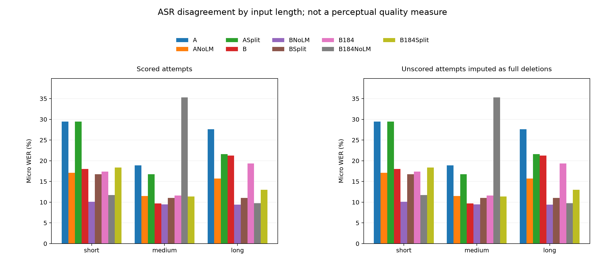

# TTS Reliability on Apple Silicon

A reproducible study of autoregressive text-to-speech reliability, built from
EECS 183/283A Homework 4 Part C and run locally on an Apple M2 Max with 64 GB
unified memory. The project investigates missing words, repetitions, and early
stopping through continued training and controlled decoding experiments.

## Results at a glance

Two training seeds each completed one additional epoch over **354,780 valid
examples**. The independent final evaluation contains **60 texts × two generation
seeds × nine systems = 1,080 scored attempts**, with no runtime exceptions.

| System | Final ASR WER |
| --- | ---: |
| Starter | 25.40% |
| Starter, no LM reference prefix | 14.69% |
| Starter, sentence splitting | 21.09% |
| Continuation, seed 183 | 17.71% |
| Continuation, seed 183, no LM reference prefix | **9.48%** |
| Continuation, seed 183, sentence splitting | 11.64% |
| Continuation, seed 184 | 17.01% |
| Continuation, seed 184, no LM reference prefix | 17.04% |
| Continuation, seed 184, sentence splitting | 13.10% |

The development-selected combination reduced WER by **15.92 percentage points**
(95% text-cluster bootstrap CI: −18.45 to −13.05) relative to the starter.
Long-text WER changed from 27.63% to 9.39%. This combines continued training and
a decoding change; it is not a training-only improvement. The second training
seed includes a severe repeated-ASR outcome, so the selected combination's gain
is **not established as stable across training seeds**.



WER is an automatic intelligibility proxy. Systematic human listening,
naturalness, and speaker-similarity evaluation remain incomplete.

## What this project adds

- A causal Transformer implementation with correctness checks and a tested KV cache.
- Local MPS execution, shape-bounded padding, and recoverable token-budget training.
- Explicit generation budgets, stop reasons, sentence splitting, and reference-prefix controls.
- Independent development/final text preparation, paired uncertainty estimates,
  failure analysis, and auditable per-attempt results.

The trainable model has **213,191,842 parameters** and starts from the course's
two-epoch checkpoint. CosyVoice2's tokenizer, speaker encoder, flow model, and
vocoder are frozen upstream components. This project does not train the full
CosyVoice2 system from scratch.

## Read the project

| Document | Purpose |
| --- | --- |
| [Technical report](docs/technical_report.md) | Research question, method, conclusions, and limitations |
| [Final results](docs/final_results.md) | All nine systems, paired comparisons, and failure modes |
| [Training results](docs/training_results.md) | Full-epoch coverage, recovery, validation, and cost |
| [Reproduction notes](docs/reproduction_notes.md) | Asset provenance and exact-run constraints |
| [Local workflow](docs/local_workflow.md) | Setup, executable commands, and experiment history |
| [Architecture guide](docs/architecture_and_interview.md) | Model, objectives, decoding, and interview preparation |
| [Contributions](docs/contributions_and_resume.md) | Ownership boundaries and evidence-based resume wording |
| [Repository contents](docs/repository_contents.md) | What is tracked, excluded, and available only locally |
| [Status](STATUS.md) | Current state and recovery guidance |

## Quick start

Validated with Python 3.12.3 and PyTorch/torchaudio 2.8.0 on macOS 15.7.9.
Run from the repository root:

```sh
mkdir -p upstream
git clone https://github.com/Louis0324/eecs183-hw4.git upstream/eecs183-hw4
git -C upstream/eecs183-hw4 checkout 48e1c407dec5a39df1a50a9069934879f175c373
python3 -m venv .venv
source scripts/env.sh
.venv/bin/python -m pip install -r requirements.txt
.venv/bin/python scripts/download_assets.py --models
.venv/bin/python scripts/prepare_training_data.py
.venv/bin/python -m pytest -q
```

These commands download substantial public assets and prepare data; they do not
start a training run. See the local workflow before running synthesis or training.
MPS availability must be checked in the actual execution environment. The LM and
flow model use MPS; prompt ONNX/STFT, vocoder complex iSTFT, and Whisper use CPU.

The repository contains code, configuration, reports, selected plots and numeric
evidence, including all 1,080 final attempt records. Downloaded data, model
weights, checkpoints, audio, personal-voice demos, caches, and full operational
logs remain local. A fresh clone therefore cannot resume the historical run
without the excluded assets. Paths in historical reports may refer to those
local-only artifacts; see the repository contents guide.

## Attribution

- Course architecture, starter, token cache, and component helpers:
  [Louis0324/eecs183-hw4](https://github.com/Louis0324/eecs183-hw4).
- Frozen speech components:
  [FunAudioLLM/CosyVoice2-0.5B](https://huggingface.co/FunAudioLLM/CosyVoice2-0.5B).
- Automatic evaluator:
  [openai/whisper-large-v3-turbo](https://huggingface.co/openai/whisper-large-v3-turbo).
- Underlying training recordings:
  [LibriTTS](https://www.openslr.org/60/), CC BY 4.0.

Upstream code, data, and model licenses remain separate. No blanket license is
assigned here to third-party materials. This repository is an independent
course-based extension, not a homework submission package.
